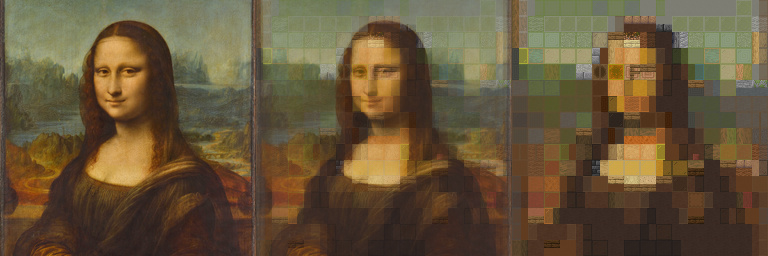
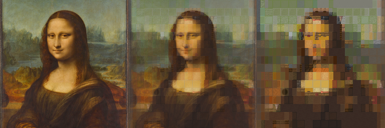

# AdeleBlock
AdeleBlock converts static images and GIFs into Minecraft block mosaics of a given size. Each source tile maps to one 16 × 16 block texture. The program can combine two or three block layers, and can use either standard sRGB (faster, less perceptually-accurate), or Oklab (slower, more perceptually-accurate).

<figure>
    
    <figcaption>The Mona Lisa, 16 blocks by 16 blocks, 2 layers</figcaption>
</figure>
<figure>
    
    <figcaption>The Mona Lisa, 16 blocks by 16 blocks, 3 layers</figcaption>
</figure>

## Requirements
- Python 3.10 or later
- NumPy (math)
- Pillow (image processing)
- tqdm (progress bar)

Install the packages:

```console
python -m pip install -r requirements.txt
```

Run the converter:

```console
python painting_converter.py
```

Select an image. Then enter the required block width, block height, and layer count. The program writes the result, each separate layer, and a block palette to `outputs/<source filename>/`.

For three-layer images, `candidates` in `userpref.ini` controls the number of two-layer matches that the program tests with every third-layer texture. A larger value can improve the result, but it increases the third-layer run time and memory use.

## Algorithm
The program loads each texture from a folder of backing, middle-layer, and overlay blocks. It then composites candidate texture batches and converts the candidates and source tiles from sRGB to Oklab.

For each candidate batch, the program calculates squared Euclidean distance with this identity, using a single matrix operation for the dot product:

```text
distance²(x, y) = ||x||² + ||y||² - 2(x · y)
```

Two-layer mode searches all backing and overlay combinations. Three-layer mode keeps the configured amount of best two-layer candidates for each source tile, and tests each third-layer texture against that shortlist.

## Name
The name combines *Portrait of Adele Bloch-Bauer I* by Gustav Klimt with Minecraft blocks.
